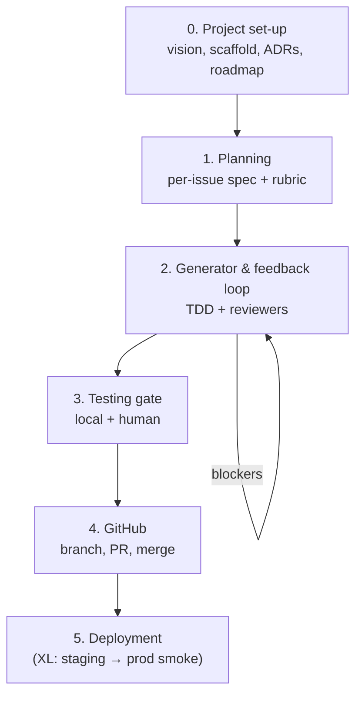
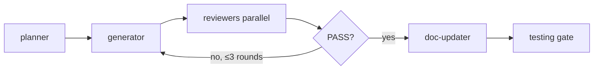
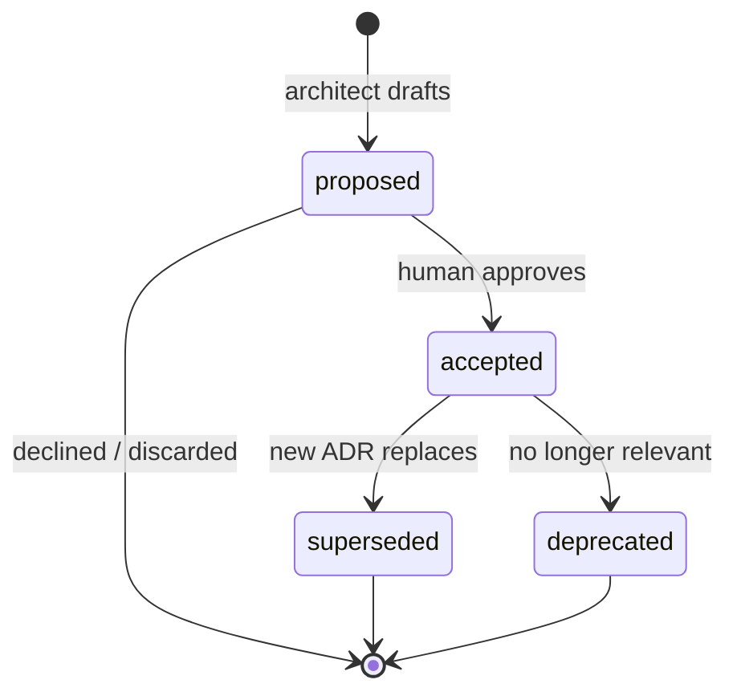
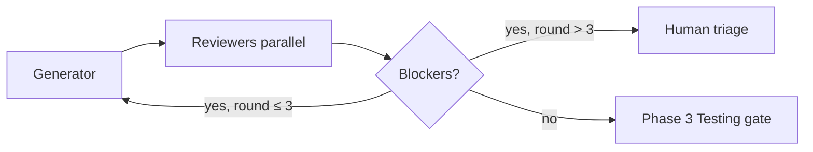

# Cursor Agent product development workflow

> **Human onboarding only.** Agents use [`AGENTS.md`](../../AGENTS.md), [`.cursor/rules/`](../../.cursor/rules/), and [`.cursor/agents/`](../../.cursor/agents/) — not this file.

High-level process for building products (websites, portals, APIs, MCPs, Python services, AI agents) with Cursor Agent, subagents, and a shared artefact library.

**Status:** Draft v0.5 — orchestration, sizing, lifecycle, CI, and library scaffold.

---

## Principles

1. **Chat is ephemeral; files are memory.** Product truth, roadmap, issue specs, and feedback live in the repo—not in conversation history.
2. **One owner per artefact.** Reviewers write review files; the generator implements fixes; neither replaces the other’s role.
3. **Size-aware ceremony.** Not every task needs every gate. Match process to scope (see [Work sizing](#work-sizing)).
4. **Issue-number traceability.** Feedback, specs, and branches tie back to GitHub issue numbers.
5. **Independent review.** Reviewers do not implement fixes; the generator does not self-approve merge readiness.
6. **All reviewers are subagents.** Every reviewer and evaluator (`code-reviewer`, `api-reviewer`, `frontend-evaluator`, `performance-evaluator`, etc.) is a dedicated subagent under `.cursor/agents/`—never a skill or inline chat pass pretending to be independent review.
7. **Decisions are recorded, not implied.** Significant architectural choices get an ADR with context, alternatives, and consequences—linked from specs, issues, and PRs. Chat and PR comments are not the system of record for *why*.
8. **Harness always runs.** Every change follows **plan → generate → review**, sized to scope. Never skip the loop—only lighten artefacts for **S**.
9. **Parent orchestrates review closure.** The main chat agent (or human) runs generator and reviewers in the prescribed order; subagents do not self-orchestrate full loops. See [`AGENTS.md`](AGENTS.md) and [`.cursor/rules/orchestration.mdc`](.cursor/rules/orchestration.mdc).

---

## Work sizing

**Agent proposes size; human confirms** before planning starts.

| Size | Scope | Issues | Harness depth |
|------|-------|--------|---------------|
| **S** | Bugfix, copy tweak, small config change | **1 issue** (always) | **Light** — short spec/rubric, `CHANGELOG.md` entry required, plan → generate → review |
| **M** | Single feature, one coherent slice | **1 issue** | **Full** per-issue spec + rubric + feedback |
| **L** | Multi-surface feature (UI + API + DB) | **Multiple issues** | **Full** + Phase 0 light if new area |
| **XL** | Greenfield product or platform | **Epics + many issues** | Full Phase 0 → 5; staging required |

**Non-negotiable:** Always create a GitHub issue. Always run **plan → generate → review**. S-sized work lightens documentation—not the loop.

### S-sized artefact set

| Required | Optional / light |
|----------|------------------|
| GitHub issue | Long spec → use [`issue-spec-subtask.md`](docs/project/templates/issue-spec-subtask.md) abbreviated |
| Short spec + rubric in `issues/<n>/` | All reviewers → rubric lists minimum gates |
| plan → generate → review | Fewer iterations if PASS first round |
| **`CHANGELOG.md` entry** | |
| Roadmap note if user-facing | |

---

## Phase overview



---

## Orchestration (parent agent)

**Enforcement:** [`AGENTS.md`](AGENTS.md) (agent contract) + [`.cursor/rules/orchestration.mdc`](.cursor/rules/orchestration.mdc) (`alwaysApply: true`). Subagents must not replace this loop.

The **parent** (main chat agent or human) owns the harness loop. Subagents complete one role and return.

### One review-closure round

1. Confirm **size** (S/M/L/XL) with human if unclear.
2. **`planner`** — issue spec + rubric (light for S/epic).
3. **`generator`** — implement + TDD + `generator-state.md` + handoff list.
4. **Reviewers in parallel** — all subagents checked in issue rubric (except doc-updater).
5. **Consolidate** — CRITICAL/HIGH, evaluator FAIL → single backlog.
6. If blockers and round **≤ 3** → **`generator`** again with backlog + feedback paths.
7. If all reviewers **PASS** → **`doc-updater`** last (docs only after green reviewers).
8. Phase 3 testing gate → Phase 4 PR.

| Rule | Value |
|------|-------|
| Max **generator** rounds per issue | **3** → then human triage |
| **doc-updater** | Runs **after** all other required reviewers PASS |
| Parallel | Independent reviewers same iteration |



---

## Project lifecycle (MVP vs live)

Document in `project.md` → **Lifecycle stage**. Drives refactor and change strictness.

| Stage | Meaning | Refactor / change bar |
|-------|---------|------------------------|
| **MVP** | Pre-launch or no production users | Rigorous refactors OK; breaking changes with migration notes |
| **Live** | Production users depend on stability | Careful refactors; ADR + migration plan; prefer additive changes |
| **Mature** | Large user base / SLAs | Stricter; feature flags for risky rollout; extended smoke |

**Change management:** See [Change & drift](#change--drift).

---

## 0. Project set-up

**Goal:** Define what we are building, scaffold the repo with the right Cursor config, and establish phased delivery.

### 0.1 Define the project

| Artefact | Path | Purpose |
|----------|------|---------|
| **Project** | `docs/project/project.md` | Ultimate product truth: rationale, problem solved, users, user stories, features, quality bar |
| **Roadmap** | `docs/project/roadmap.md` | Phases (epic issues), ordered delivery, goals/rationale per phase, high-level context per subtask |
| **Global eval rubric** | `docs/project/eval-rubric.md` | Product-wide quality bar—every issue and reviewer inherits this (template: `docs/project/templates/eval-rubric.md`) |
| **Generator state** | `docs/project/generator-state.md` | Operational memory: current/previous task, delivered issues, backlog not yet filed as issues |
| **Setup / CI** | `docs/project/setup.md` | Harness profile, **CI commands**, MCPs, env vars — update when toolchain changes |
| **Changelog** | `CHANGELOG.md` (repo root) | User-facing changes; **required for every S issue** and notable M+ merges |
| **Env template** | `.env.example` | Required; all secrets documented by name, never valued |

**After `project.md` exists:** complete **Delivery requirements** section (tech stack, hosting, CI, MCPs, observability) — what is needed to ship.

**Templates:** [`docs/project/templates/`](docs/project/templates/) · **Bootstrap:** [`GETTING_STARTED.md`](GETTING_STARTED.md) · **Script:** `scripts/scaffold-project.sh`

**Naming note:** Use `project.md` for vision-level truth. Per-issue detailed specs live under `docs/project/issues/<n>/` (see Phase 1).

### 0.2 Scaffold from agent-development library

This repo (**agent-development**) is the **canonical library**. Product repos copy a **subset** via profile—not every rule/agent.

| Surface | Location in agent-development | In product repo |
|---------|----------------------|-----------------|
| Rules | `.cursor/rules/` | Subset per profile |
| Subagents | `.cursor/agents/` | Subset per profile |
| Skills | `.cursor/skills/` | Optional subset |
| Hooks | `.cursor/hooks.json` | Recommended |
| GitHub | `.github/` | PR template, CI workflow from `setup.md` |

```bash
./scripts/scaffold-project.sh --profile nextjs-app --target ../my-product
```

Profiles: [`docs/profiles/`](docs/profiles/). See [GETTING_STARTED.md](GETTING_STARTED.md).

**Output:** `docs/project/setup.md` listing enabled profile, CI commands, MCPs, and subagents.

### 0.3 Architecture & tech choices

**Primary agent:** `architect`.

1. Resolve stack, boundaries, and major trade-offs.
2. Document in `project.md` → **Technical stack** + **Delivery requirements**.
3. Record **significant** choices as ADRs (see [ADR strategy](#architecture-decision-records-adr-strategy)).
4. Initialize `docs/adr/` for L/XL; create on first fork for S/M.

**No separate blueprint file.** Roadmap + issues + ADRs sequence delivery.

**Exit criteria (L/XL):**

- [ ] `project.md` complete including delivery requirements and lifecycle stage
- [ ] `setup.md` with CI commands and `.env.example` present
- [ ] Foundation ADRs for non-obvious stack choices
- [ ] `docs/adr/README.md` index updated

### 0.4 CI profile (`setup.md`)

Define **exact commands** in Phase 0; update when toolchain changes. Used by Phase 3 gate, reviewers, and GitHub Actions.

```markdown
## CI commands
| Check | Command |
|-------|---------|
| typecheck | `npm run typecheck` |
| lint | `npm run lint` |
| test | `npm test` |
| e2e | `npm run test:e2e` |
| build | `npm run build` |
```

Mirror these in `.github/workflows/ci.yml` when CI is enabled.

### 0.5 Roadmap → GitHub

- Each **phase** → **epic issue** (milestone optional).
- Each **subtask** → **child issue** linked to epic.
- Roadmap remains canonical for *intent and ordering*; GitHub Issues are canonical for *execution and assignment*.

Every issue body includes:
- Link to `project.md` section
- Link to `roadmap.md` phase/subtask
- Acceptance criteria checklist (refined in Phase 1)

---

## Architecture Decision Records (ADR strategy)

ADRs capture **why** significant technical choices were made. They complement—not replace—`project.md`, issue specs, and rubrics.

### `project.md` vs ADR

| | `project.md` | ADR (`docs/adr/NNNN-*.md`) |
|--|--------------|----------------------------|
| **Answers** | What are we building? What do we use *today*? | Why this choice over alternatives? |
| **Audience** | Planner, generator, whole team | Future maintainers, reviewers, new agents |
| **Changes** | Updated when product or stack shifts | Immutable history; supersede with new ADR |
| **Depth** | Summary bullets | Context, alternatives, consequences |

**Rule:** If reversing the decision would cause meaningful rework, it likely needs an ADR.

### When to create an ADR

| Trigger | Phase | Owner |
|---------|-------|-------|
| Greenfield stack selection (framework, language, DB, hosting) | 0 | `architect` → human accepts |
| Auth / authorization model | 0 or 1 | `architect` |
| API paradigm (REST vs GraphQL vs tRPC); MCP vs HTTP-only | 0 or 1 | `architect` + `api-reviewer` input |
| Monolith vs services; event-driven; multi-tenant model | 0 | `architect` |
| Schema / persistence pattern with trade-offs | 1 or 2 | `architect` or `database-reviewer` suggests |
| Security mechanism (session vs JWT, RLS approach) | 0 or 1 | `architect` + `security-reviewer` input |
| Deployment / CI model; staging strategy | 0 (XL) | `architect` |
| Replacing a prior accepted decision | Any | New ADR **supersedes** old; update index |

**Do not ADR:** naming conventions, formatting, single-library picks with no alternatives, issue-local implementation details already fully specified in the issue spec.

### Who does what

| Role | Responsibility |
|------|----------------|
| **`architect` subagent** | Proposes ADR drafts; reads existing ADRs before design work |
| **`planner` subagent** | Links relevant ADRs in issue specs; flags unresolved forks → architect |
| **Human** | **Accepts** ADRs (`proposed` → `accepted`); resolves disputed trade-offs |
| **`generator` subagent** | Reads accepted ADRs before implementing; **stops and escalates** if implementation requires a new architectural fork not covered by an ADR |
| **`code-reviewer` subagent** | Flags PRs that introduce architectural change without a linked ADR |
| **Skill** | `architecture-decision-records` — format and capture playbook (library) |

### Lifecycle



| Status | Meaning |
|--------|---------|
| **proposed** | Under discussion; **do not** treat as binding for implementation |
| **accepted** | In effect; generator and reviewers must follow |
| **deprecated** | Obsolete (feature removed, context gone) |
| **superseded by ADR-NNNN** | Replaced; link to successor |

### Workflow: capturing a decision

1. **Detect** — explicit (“ADR this”) or implicit (comparing alternatives during Phase 0/1/2).
2. **Draft** — `architect` (or parent agent with skill) fills [`docs/adr/template.md`](docs/adr/template.md): Context, Decision, Alternatives, Consequences.
3. **Review** — present draft to **human**; do not mark `accepted` without approval.
4. **Number** — next sequential `NNNN` in `docs/adr/` (e.g. `0003-rest-over-graphql.md`).
5. **Index** — append row to [`docs/adr/README.md`](docs/adr/README.md).
6. **Link** — reference ADR from `project.md`, issue spec, PR body (`Refs ADR-0003`), and roadmap phase when applicable.
7. **Implement** — generator proceeds only after **accepted** ADR exists for binding choices.

### ADR format (summary)

Full template: [`docs/adr/template.md`](docs/adr/template.md). Required sections:

- **Context** — problem, constraints, forces (2–5 sentences)
- **Decision** — clear statement of what we chose
- **Alternatives considered** — at least one rejected option with rationale
- **Consequences** — positive, negative, risks + mitigations
- **Status / Date / Deciders / Links** — issues, PRs, related ADRs

Keep each ADR readable in ~2 minutes.

### Integration by phase

| Phase | ADR activity |
|-------|----------------|
| **0** | Initialize `docs/adr/`; foundation ADRs for stack, auth, data, deploy |
| **1** | Planner reads ADRs; issue spec lists `## Related ADRs`; new ADR if planning exposes a fork |
| **2** | Generator reads related ADRs; architect drafts ADR before implementing unresolved forks |
| **3–4** | PR lists ADRs touched/created; code-reviewer checks linkage |
| **5 (XL)** | Deployment ADRs inform staging smoke scope |

### Issue & PR linkage

**Issue spec** (`docs/project/issues/<n>/spec.md`):

```markdown
## Related ADRs
- [ADR-0001](../../adr/0001-use-nextjs.md) — framework choice
- [ADR-0004](../../adr/0004-clerk-auth.md) — auth model (must comply)
```

**PR body:**

```markdown
## Decisions
- Refs ADR-0004 (auth model — no change)
- Adds ADR-0007 (caching strategy) — accepted in this PR
```

---

## 1. Planning (per issue)

**Goal:** Before implementation, every issue has a clear, testable definition—depth depends on issue type.

**Primary agent:** `planner` (+ `architect` when boundaries are unclear; user interview / research as input).

### Planning depth by issue type

| Issue type | Spec | Rubric |
|------------|------|--------|
| **Epic** (phase) | **Light** — phase goals, dependencies, integration intent, child-issue map | **Light** — phase checkpoints, “all children done” criteria |
| **Subtask** (implementable) | **Full** — scope, AC, UX/API behavior, file impact, out-of-scope | **Full** — must-pass flows, edge cases, evidence (extends global rubric) |

Epics are planning/coordination issues; **only subtasks** enter the generator loop unless explicitly scoped otherwise.

### Artefacts per issue

| File | Path | Purpose |
|------|------|---------|
| **Issue spec** | `docs/project/issues/<n>/spec.md` | What to build for this issue (light or full) |
| **Issue rubric** | `docs/project/issues/<n>/rubric.md` | How to confirm this issue is done (light or full) |

### Global vs per-issue rubric (hybrid — confirmed)

Two layers work together on **every subtask** (and epics use a light per-issue rubric):

| Layer | File | Answers |
|-------|------|---------|
| **Global** | `docs/project/eval-rubric.md` | “What does *good* mean for this *product* everywhere?” |
| **Per-issue** | `docs/project/issues/<n>/rubric.md` | “What must *this issue* specifically prove before we close it?” |

**Templates:** Copy from `docs/project/templates/` when creating rubrics (see [Project docs README](docs/project/README.md)).

**Global rubric** — created in Phase 0, refined by planner when product bar shifts:

- Weighted dimensions with product-specific bullets (e.g. Design, Craft, Functionality, Security)
- Non-negotiables: accessibility baseline, brand/anti-slop rules, error/empty/loading expectations
- Default pass threshold (e.g. weighted score ≥ 7.0)
- Cross-cutting must-pass flows that span many issues (e.g. “signed-in user can sign out from any page”)

**Per-issue rubric** — created in Phase 1 by planner; **extends** global (never replaces it):

- Link to `eval-rubric.md` at top of file
- Issue-specific must-pass flows and edge cases
- Required reviewer subagents for this issue
- Evidence for this issue (URLs, API calls, Playwright paths)
- Optional dimension overrides with explicit reason

**Reviewers and evaluators read both.** Fail if either is violated.

### Inputs to planning

1. `project.md` + `roadmap.md`
2. **Relevant ADRs** from `docs/adr/README.md` (read before spec work)
3. GitHub issue body
4. Online research (Context7, vendor docs, web)
5. **User interview** — answers feed directly into issue spec/plan; important forks → ADR (no separate interview file)

### Planning exit criteria

- [ ] `eval-rubric.md` exists and is linked from issue rubric
- [ ] Related **accepted** ADRs linked in issue spec (or N/A documented)
- [ ] Scope and out-of-scope are explicit
- [ ] Acceptance criteria are testable
- [ ] Issue rubric lists must-pass flows, required reviewer subagents, and evidence
- [ ] Issue updated on GitHub with links to spec + rubric paths

---

## 2. Generator & feedback loop

**Goal:** Implement the issue spec with TDD; iterate with independent reviewers until merge-ready.

**Orchestrator:** Top-level chat agent (human + parent agent)—not nested inside a single generator run.

**Implementer:** `generator` subagent.

### 2.1 Generator run

1. Read `docs/project/eval-rubric.md`, `docs/project/issues/<n>/spec.md`, and `rubric.md`
2. Read **Related ADRs** linked from issue spec (accepted only unless explicitly implementing a proposed ADR)
3. Read GitHub issue `#n`
4. Read prior feedback for this issue in `docs/project/feedback/<n>/` (files from earlier iterations, if any)
5. If implementation requires an architectural fork **not covered** by an accepted ADR → stop; invoke `architect` to draft ADR; wait for human acceptance
6. Implement with **TDD** where behavior is testable (RED → GREEN → REFACTOR)
7. Update `docs/project/generator-state.md`
8. Hand off to reviewers (list which gates apply and current iteration number `<i>`)

### 2.2 Reviewers (invoke by trigger)

**All entries below are subagents** (`.cursor/agents/<name>.md`). Run **in parallel** where independent. Not every issue needs every reviewer—`rubric.md` lists which apply.

**All feedback for one issue lives in a single folder:** `docs/project/feedback/<n>/`. Iteration is encoded in **filenames**, not subfolders.

| Subagent | When | Output file |
|----------|------|-------------|
| **code-reviewer** | Substantive TS/JS/Python/code changes; **flags missing ADR** on architectural diffs | `docs/project/feedback/<n>/code-review-i<i>.md` |
| **api-reviewer** | Route handlers, REST/GraphQL contracts | `docs/project/feedback/<n>/api-review-i<i>.md` |
| **mcp-reviewer** | MCP tools, schemas, auth | `docs/project/feedback/<n>/mcp-review-i<i>.md` |
| **database-reviewer** | Migrations, SQL, RLS, indexes | `docs/project/feedback/<n>/database-review-i<i>.md` |
| **security-reviewer** | Auth, secrets, input, OWASP surfaces | `docs/project/feedback/<n>/security-review-i<i>.md` |
| **frontend-evaluator** | UI/UX flows in running app | `docs/project/feedback/<n>/frontend-eval-i<i>.md` |
| **performance-evaluator** | Perf budgets, Lighthouse, load-sensitive paths | `docs/project/feedback/<n>/performance-eval-i<i>.md` |
| **doc-updater** | After **all other** required reviewers PASS | `docs/project/feedback/<n>/docs-review-i<i>.md` |

- `<n>` = **GitHub issue number**
- `<i>` = **iteration** (1, 2, 3 — matches generator round)

**doc-updater runs last** in the closure round—only when code, security, eval, and contract reviewers are green.

**Example** (`docs/project/feedback/142/`):

```text
code-review-i1.md
frontend-eval-i1.md
generator-response-i1.md
code-review-i2.md
security-review-i2.md
generator-response-i2.md
frontend-eval-i3.md
```

Each iteration adds **new files**. Reviewers never edit files from a previous iteration.

### 2.3 Feedback file format

Each reviewer subagent **creates** its iteration file (immutable once written). Structure:

```markdown
# [Domain] review — Issue #142 — Iteration 2

## Verdict
PASS | FAIL | PASS WITH NOTES

## Blockers (CRITICAL / HIGH)
- ...

## Findings (MEDIUM / LOW)
- ...

## Evidence
- Commands run, URLs, screenshot refs

## References
- Global rubric: docs/project/eval-rubric.md
- Issue rubric: docs/project/issues/142/rubric.md
```

**Generator response** (separate file, generator-owned):

`docs/project/feedback/<n>/generator-response-i<i>.md`

```markdown
# Generator response — Issue #142 — Iteration 2

## Addressed from iteration 2 reviews
- code-review: ...
- frontend-eval: ...

## Not addressed (reason)
- ...

## Commands run
- ...
```

**Rules:**

- Reviewer subagents write **only** their `*-review-i<i>.md` / `*-eval-i<i>.md` files for the current iteration.
- Generator writes **only** `generator-response-i<i>.md` for that iteration before the next round.
- Iteration `<i+1>` reviewers read iteration `<i>` files in the same issue folder; they do not mutate older files.

### 2.4 Closure loop

One **round** = one generator run → all required reviewers → consolidate blockers.

| Rule | Value |
|------|-------|
| Max generator rounds per issue | **3** (then escalate to human) |
| Merge blockers | CRITICAL/HIGH from code/security/api/database; evaluator FAIL on must-pass flows |
| Early stop | All required reviewers PASS → proceed to Phase 3 |



---

## 3. Testing gate (pre-push)

**Goal:** No code reaches GitHub until automated and human checks pass locally.

This complements TDD in Phase 2—it is the **final gate** before commit/push, not a substitute for tests during implementation.

### Automated (project-defined profile)

Run whatever the harness profile enables, typically:

- Typecheck
- Lint
- Unit / integration tests
- API contract tests
- DB migration test (`db:test:migrate` when applicable)
- E2E / Playwright smoke (local or against dev server)

### Human testing

- Walk must-pass flows from `eval-rubric.md` + issue `rubric.md`
- Exploratory testing for UX and edge cases
- Sign-off recorded in PR test plan or issue comment

### Exit criteria

- [ ] All configured local commands green
- [ ] Human sign-off on rubric must-pass flows (when UI/product-facing)
- [ ] No open CRITICAL/HIGH in feedback files

---

## 4. GitHub (branch, PR, merge)

**Strategy:** **[GitHub Flow](https://docs.github.com/en/get-started/using-github/github-flow)** — not GitFlow.

| Rule | Detail |
|------|--------|
| Protected `main` | Never commit or push directly to `main` |
| Branches | Short-lived feature branches off `main` |
| Naming | `feature/<issue-n>-short-slug`, `fix/<issue-n>-slug` |
| Commits | [Conventional Commits](https://www.conventionalcommits.org/) — `feat:`, `fix:`, `test:`, … |
| PR footer | `Closes #n` or `Refs #n` |
| Merge | After CI green + review policy satisfied |

### PR contents

- Summary (what / why)
- Test plan checklist
- Links to `docs/project/issues/<n>/spec.md`, feedback folder, and **ADRs** (`Refs ADR-NNNN`)
- Harness exception note if `skip-harness-check` (rare)

### After merge

- Close or update GitHub issue with deliverables summary
- **Update `roadmap.md`** — mark subtask/phase progress (required after every issue)
- Update `generator-state.md`
- Add **`CHANGELOG.md`** entry (required for S; recommended for all user-facing M+)
- `doc-updater` refreshes user-facing docs when structure/API changed

### Epic closure (subtask)

Closing an epic is a **dedicated subtask issue**:

- [ ] All child issues closed
- [ ] Phase rubric checkpoints PASS
- [ ] `roadmap.md` epic marked complete
- [ ] Optional: [Retrospective](#retrospective) for the phase

---

## Change & drift

When specs, stack, or scope diverge from reality—refactor carefully per **lifecycle stage** in `project.md`.

| Situation | Action |
|-----------|--------|
| Issue spec wrong mid-work | Update `issues/<n>/spec.md` + issue comment; ADR if architectural |
| Product pivot | Update `project.md` + `roadmap.md`; new ADRs supersede old |
| **MVP** refactor | Allowed; note in PR; update tests |
| **Live** refactor | ADR or explicit plan; migrations; extended smoke; prefer additive first |
| Roadmap drift | Sync after **every** closed issue |

Issue spec **Change log** section records deltas (see template).

---

## Retrospective

After **epic closure** or XL phase (optional for M):

- What repeated in feedback? → rubric or rule update
- ADRs still accurate?
- CI/profile gaps in `setup.md`?
- Output: short note in `docs/project/retrospectives/YYYY-MM-DD-<phase>.md` or epic issue comment

---

## 5. Deployment

**Goal:** Verify changes in live-like environments. **Staging is required only for XL** projects; S/M/L rely on local testing + CI + optional PR preview URLs.

### Environments by project size

| Environment | S / M / L | XL |
|-------------|-----------|-----|
| **Local** | Phase 2 evaluators + Phase 3 gate | Same |
| **PR preview** | Optional (hosting-dependent) | Optional |
| **Staging** | Not required | **Required** — persistent pre-prod |
| **Production** | Deploy from `main` per project policy | After staging smoke passes |

### XL: staging verification

1. Deploy `main` (or release branch) to staging.
2. Run **post-deploy smoke** against `STAGING_URL`:
   - Health check
   - Playwright subset
   - API contract smoke
3. Record results in issue or release note.

### Production promotion (document in `project.md`)

- **Continuous:** merge to `main` auto-deploys production
- **Tagged release:** semver tags trigger production deploy
- **Manual approval:** human promotes after checks

### Deployment exit criteria

**S / M / L**

- [ ] Phase 3 local gate PASS
- [ ] CI on PR PASS
- [ ] PR preview smoke (when preview URL exists)

**XL (additional)**

- [ ] Staging deploy successful
- [ ] Post-deploy Playwright / smoke PASS on staging
- [ ] Rollback path documented for risky changes

---

## Repository layout (summary)

```text
AGENTS.md                          # Agent contract + setup coach
docs/guides/workflow-explainer.md  # This document (human FAQ)
.cursor/
  rules/                           # From library profile
  agents/
  skills/
  hooks.json
docs/project/
  project.md                       # Product vision & truth
  roadmap.md                       # Phases → epics → subtasks
  eval-rubric.md                   # Global quality bar (all issues)
  generator-state.md               # Current memory / handoff
  setup.md                         # Harness profile (optional)
  templates/
    project.md
    roadmap.md
    setup.md
    generator-state.md
    issue-spec-subtask.md
    issue-spec-epic-light.md
    issue-rubric-subtask.md
    issue-rubric-epic-light.md
    github-issue.md
  retrospectives/
CHANGELOG.md                       # Root changelog (S required)
.env.example
  issues/
    <n>/
      spec.md                      # Per-issue spec (light for epics)
      rubric.md                    # Per-issue rubric (extends global)
  feedback/
    <n>/                           # One folder per GitHub issue
      code-review-i1.md
      frontend-eval-i1.md
      generator-response-i1.md
      code-review-i2.md
      ...
docs/adr/                          # Architecture Decision Records
  README.md                        # Index (required)
  template.md                      # Copy for new ADRs
  NNNN-short-title.md              # Sequential ADRs
```

---

## Resolved decisions

| Topic | Decision |
|-------|----------|
| Epic planning | **Light** spec + rubric for epics; **full** for subtasks |
| Global rubric | **Confirmed hybrid** — `eval-rubric.md` (global) + `issues/<n>/rubric.md` (per issue); templates in `docs/project/templates/` |
| Performance review | **`performance-evaluator`** — separate subagent |
| All reviewers | **Always subagents** — never skills or inline chat |
| Staging | **XL only** — S/M/L use local + CI (+ optional PR preview) |
| Feedback iterations | **One folder per issue** (`feedback/<n>/`); iteration in filename (`code-review-i2.md`) |
| ADRs | **`docs/adr/`** — architect drafts; **human accepts**; link from specs, issues, PRs |
| Orchestration | **`AGENTS.md` + `orchestration.mdc`** — parent owns plan → generate → review loop |
| Harness | **Always runs**; S lightens artefacts, never skips loop |
| Blueprint | **Removed** — roadmap + issues + ADRs instead |
| Monorepo | **Default** — one repo per product (see appendix) |
| doc-updater | **After** other reviewers PASS |

---

## Appendix — decisions & FAQ

### MCP products vs Context7

**Context7** fetches **library documentation** (Next.js, MCP SDK, etc.) during implementation—it does not replace an MCP product playbook.

For MCP servers, still use: **`mcp-reviewer` subagent**, stack rule (when added), and Context7 for **current** MCP SDK docs. Consider a `.cursor/skills/mcp-patterns/` skill for tool schema and auth conventions.

### “AI Agent products” (what we meant)

Products where **an LLM orchestrates tools** (customer support bot, research agent, codegen agent)—not just a app with an AI feature. Extra concerns: prompt injection, tool allowlists, human-in-the-loop, eval datasets. **Defer dedicated agent-design rules** until you build one; security-reviewer + ADR cover most MVP cases.

### Monorepo vs multi-repo

| | Monorepo (recommended default) | Multi-repo |
|--|-------------------------------|------------|
| **Fit** | One product, web + API + MCP in one deliverable | Separate teams/services with independent release cycles |
| **This workflow** | Single `docs/project/`, one roadmap | Capability doc + linked issues per repo |
| **Recommendation** | **Start monorepo** unless clear boundary (e.g. public SDK vs private app) |

Document choice in `project.md` → Delivery requirements. No need for separate blueprint file.

### Feature flags

**Toggle code paths without redeploying**—ship to production with feature off, enable gradually.

| Stage | Recommendation |
|-------|----------------|
| MVP | Optional; use env vars or simple config |
| Live | Use for risky features (new auth flow, billing change) |
| Implementation | ADR if introducing a flag service; document in `project.md` |

Not required for agent-development framework itself until Live stage.

### Observability

See [`.cursor/rules/observability.mdc`](.cursor/rules/observability.mdc): structured logging, error tracking, health checks, deployment smoke. Required in `project.md` Delivery requirements for L/XL and Live stage.

---

## Related references

- Project docs index: `docs/project/README.md`
- ADR index & template: `docs/adr/README.md`, `docs/adr/template.md`
- Feedback naming: `docs/project/feedback/README.md`
- Rubric templates: `docs/project/templates/`
- ADR skill: `.cursor/skills/architecture-decision-records/SKILL.md`
- Agent contract: `AGENTS.md`
- Git strategy: `.cursor/skills/git-workflow/SKILL.md` (GitHub Flow)