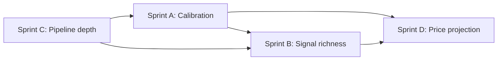

# FinBERT & Decision Engine Optimization — Master Roadmap

> **For agentic workers:** Work **one sprint at a time** in order (A → B → C → D). Each sprint has its own plan file and must pass verification before the next starts. Use `superpowers:executing-plans` or `superpowers:subagent-driven-development` within a sprint.

**Goal:** Maximize FinBERT’s predictive value, align formulas with institutional quant practice, and produce **calibrated** multi-horizon scores and price projections — not point-certain forecasts (impossible in liquid markets).

**Architecture:** Four sequential sprints: (A) measure and tune against realized returns; (B) enrich the scoring formula with full FinBERT features; (C) deepen the NLP pipeline; (D) wire sentiment edge into price paths with uncertainty bands. Shared calibration config from Sprint A is consumed by B and D.

**Tech stack:** Go (`api/internal/services`), TypeScript (`web/src/lib/price-outlook.ts`), Postgres (`news_features`, `symbol_feature_snapshots`, `article_sentiment`, `market_candles`), optional DuckDB export (ADR 003) for large backtests.

**Research reference:** `my-research.md` (Calculation rules, §1.1–1.5)

---

## Sprint order and dependencies

| Sprint | Plan file | Depends on | Delivers |
|--------|-----------|------------|----------|
| **A** | [2026-05-19-sprint-a-calibration.md](./2026-05-19-sprint-a-calibration.md) | Historical snapshots + candles | IC/Brier/hit-rate reports; tuned `CalibrationParams` applied to engine + P(up) |
| **B** | `2026-05-19-sprint-b-signal-richness.md` (create when A done) | A’s params + feature schema | Full `FinalScore(T)`; deduped sentiment/FinBERT; all FinBERT fields in formula |
| **C** | `2026-05-19-sprint-c-pipeline-depth.md` (create when B scoped) | — (can start parallel to B after A if resourced) | Full-text scoring, relevance weights, batch FinBERT, optional model swap |
| **D** | `2026-05-19-sprint-d-price-projection.md` (create when B done) | A + B | FinBERT edge in `P_T` / P(up); ±1σ projection bands |

**Start now:** Sprint A only.

---

## Cross-cutting acceptance criteria (all sprints)

- [ ] No regression: existing `decision_engine_test.go` and `finbert_aggregate_test.go` pass
- [ ] Zero-data policy preserved: no fake neutral 50 without inputs (`hasScorableInputs`, `categorySignalStrength`)
- [ ] `my-research.md` Calculation rules updated when formulas change
- [ ] `web/src/lib/scoring-methodology.ts` stays aligned with live formulas
- [ ] Feature doc created/updated per sprint in `docs/features/`

---

## Sprint A — Calibration-first (implemented — run backtest on your data)

**Outcome:** Backtest FinBERT + decision features vs forward returns (3D / 1W / 1M); tune weights, sigmoid, composite blend, and P(up) to maximize **information coefficient (IC)** and minimize **Brier score** on direction.

**Detailed plan:** [2026-05-19-sprint-a-calibration.md](./2026-05-19-sprint-a-calibration.md)

**Definition of done (Sprint A):**

- [ ] Backtest harness replays `symbol_feature_snapshots` (or reconstructs from `article_sentiment` + candles) with point-in-time discipline
- [ ] Report: IC, hit rate, Brier, sample size per horizon and per feature family (FinBERT vs technical)
- [ ] `CalibrationParams` (YAML or Go struct) checked into repo with values from last backtest run
- [ ] `decision_engine.go` / `decision_math.go` read params instead of hard-coded magic numbers where tuned
- [ ] `price-outlook.ts` `compositeToProbability` uses same calibrated logistic scale
- [ ] Runbook snippet: how to re-run calibration after 30+ days of new snapshots

---

## Sprint B — Signal richness (implemented)

**Outcome:** Implement research-target `FinalScore(T) = Σᵢ (CategoryScoreᵢ × Weightᵢ × Confidenceᵢ) − RiskPenalty + RegimeAdjustment` per horizon; use **every** aggregated FinBERT field; remove double-counting between `sentiment` and `finbert` categories.

**Planned scope (high level — detail plan after A):**

| FinBERT field (today) | Target use |
|----------------------|------------|
| `AvgProbPositive/Negative/Neutral` (1h, 4h, 24h) | Horizon-specific softmax edge, not 24h-only |
| `WeightedSentiment*` | Primary signed score per window |
| `Positive/NegativeLabelPct*` | Wilson confidence + stance |
| `LabelEntropy24h` | Down-weight noisy/agreement-free windows |
| `HighConfPositive/Negative*` | Spike / override inputs |
| `MaxProbPositive/Negative24h` | Tail-risk sentiment flag |
| `MaxConfidence24h` | Cap or boost category confidence |

**Dedup rule (design intent):** Single **news signal** path into horizons — FinBERT-led with legacy `avg_sentiment_*` as fallback only when FinBERT missing.

**Out of scope for B:** New model weights (Sprint C); projection bands (Sprint D).

---

## Sprint C — Pipeline depth (implemented)

**Outcome:** Score more text, weight by relevance/entity, score faster at scale.

**Planned scope:**

- [ ] Prefer `input_mode`: `excerpt` → `full_text` when `cleaned_text` length &lt; 512 tokens; keep `title_only` fast path
- [ ] Multiply article score by `article_symbols.relevance_score` in aggregation (`finbert_aggregate.go`)
- [ ] Batch `/analyze` endpoint or worker queue (reduce HTTP overhead vs per-article calls)
- [ ] Document optional model IDs (`FINBERT_MODEL_ID`) and evaluation gate before swap
- [ ] n8n/workflow notes in `docs/runbooks/finbert-ingest.md`

**Feeds:** Richer rows → better Sprint A backtests on re-run.

---

## Sprint D — Price projection (implemented)

**Outcome:** FinBERT-calibrated edge drives `P_T` and P(up); charts show **intervals**, not a single deterministic line.

**Planned scope:**

- [ ] `expectedReturnPct`: add `finbertEdge` term from calibrated signed score (Sprint A params)
- [ ] `compositeToProbability`: FinBERT 24h edge as explicit prior (not only composite)
- [ ] Upper/lower paths: `P₀ × (1 + μ·√t ± σ·√t)` per anchor (Hull / vol-scaling convention in `my-research.md`)
- [ ] UI: shaded band in `price-outlook-chart-dialog.tsx`; tooltip shows μ and ±1σ
- [ ] API option: expose projection JSON from Go for parity (optional; TS can remain source of truth if backtest is TS-only)

**Honest UX copy:** “Model projection band, not a price guarantee.”

---

## Risk register (all sprints)

| Risk | Mitigation |
|------|------------|
| Sparse snapshot history | Sprint A: minimum N snapshots per symbol; report coverage % |
| Look-ahead bias | Point-in-time joins only; no `ORDER BY ts DESC LIMIT 1` without `ts <= event_time` |
| Overfitting tuned weights | Hold-out symbol set + walk-forward window in backtest CLI |
| Confidence gate (35%) hides valid FinBERT | Sprint A explicitly tunes confidence formula vs hit rate |
| User expectation of “certain” prices | Docs + UI disclaimers; bands in Sprint D |

---

## Documentation checklist (per sprint)

| Sprint | Feature doc | README | ADR |
|--------|-------------|--------|-----|
| A | `docs/features/NNN-calibration-backtest.md` | Add `make calibration` or `go run ./cmd/calibrate` | Only if DuckDB becomes required for backtest |
| B | Update decision-engine feature doc | — | — |
| C | FinBERT pipeline doc | FinBERT env vars | — |
| D | Price projection doc | — | — |

---

## Execution handoff

1. Open [2026-05-19-sprint-a-calibration.md](./2026-05-19-sprint-a-calibration.md) and execute tasks in order.
2. When Sprint A DoD is met, create `2026-05-19-sprint-b-signal-richness.md` using the B outline above + Sprint A learnings.
3. Repeat for C and D.

**Which execution mode?** Subagent per task (recommended) or inline in one session — user choice when starting Sprint A.
